<div align="center">

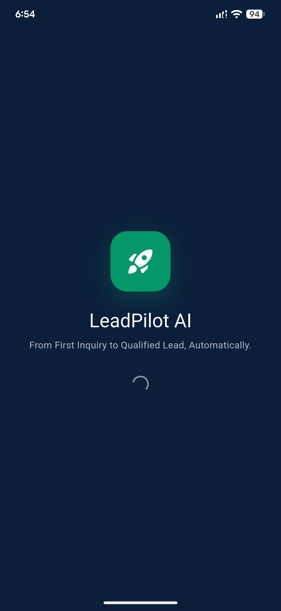

# 🚀 LeadPilot AI

### AI-Powered Lead Management, Qualification & Sales Automation

**Capture leads. Understand intent. Automate follow-ups. Keep humans in control.**

<br>


<br>


<br><br>


<br><br>

[Features](#-core-features) •
[Screenshots](#-application-screenshots) •
[Workflows](#-n8n-automation-workflows) •
[Architecture](#-architecture) •
[Setup](#-installation--local-setup) •
[Roadmap](#-roadmap)

</div>

---

## 📖 Overview

**LeadPilot AI** is an AI-assisted lead management and sales automation platform that streamlines the sales pipeline, from the first inquiry to follow-up and approval.

It combines a **Flutter** app, **FastAPI** backend, **Google Gemini** AI, **Firebase** services, and **n8n** workflow automation into one connected system.

> ### 💡 Core Philosophy
> **AI prepares → Automation coordinates → Humans approve consequential outbound actions.**

> [!NOTE]
> **Project status:** Eight named n8n workflows are included. Successful execution evidence is currently available for workflows **01, 03, and 05**. The others are presented as configured components, not as independently verified successful executions.

---

## ✨ Core Features

| | Feature | Description |
|:-:|---|---|
| 📥 | **Lead Inbox** | Centralized management of incoming sales inquiries |
| 🧠 | **AI Lead Qualification** | AI-assisted lead scoring, intent and urgency assessment |
| 🧭 | **Lead Routing** | Workflow-based lead routing and activity logging |
| ✍️ | **Follow-up Generation** | AI-assisted follow-up message drafting |
| ✅ | **Approval Management** | Human approval before configured outbound actions |
| 📅 | **Booking Processing** | Booking-related workflow coordination |
| 🛠️ | **Error Handling** | Error notification and retry workflow |
| 📊 | **Daily Reporting** | Automated operational summary |
| 🔐 | **Authentication** | Firebase Authentication integration |
| ⚡ | **Backend API** | FastAPI-based application services |

---

## 📱 Application Screenshots

<div align="center">
<table>
  <tr>
    <td align="center"><b>📊 Dashboard</b></td>
    <td align="center"><b>👥 Lead Management</b></td>
    <td align="center"><b>✅ Approval Workflow</b></td>
    <td align="center"><b>🕘 Approval History</b></td>
  </tr>
  <tr>
    <td>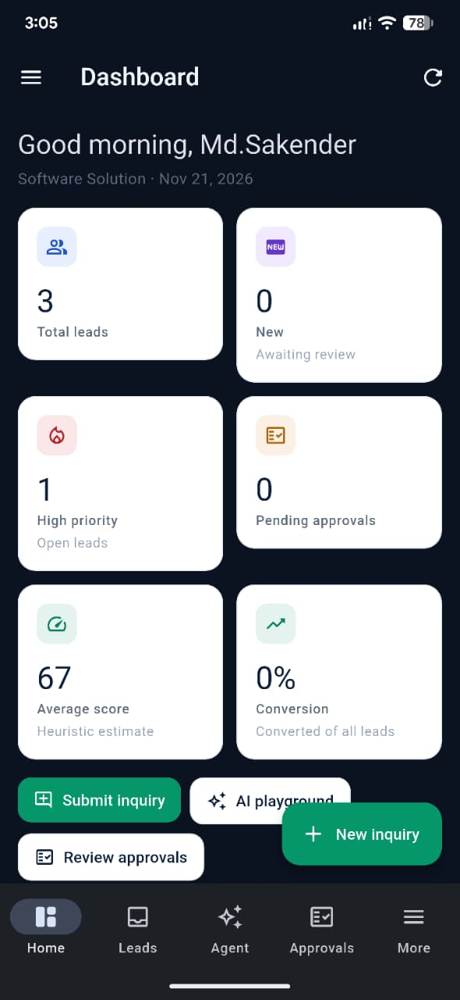</td>
    <td>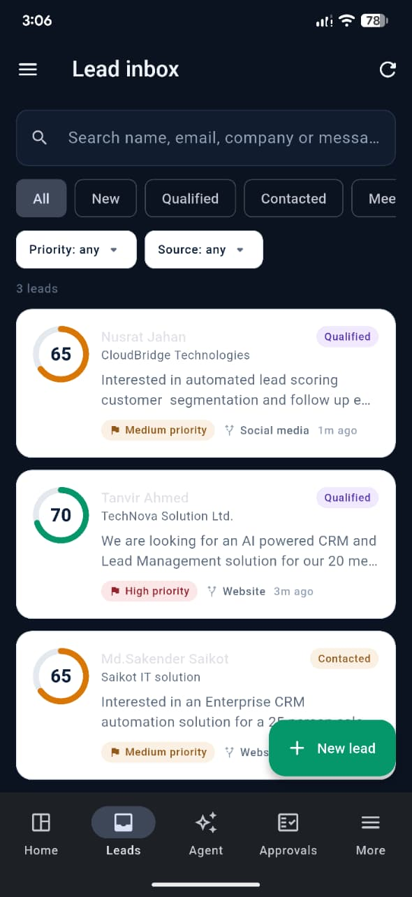</td>
    <td>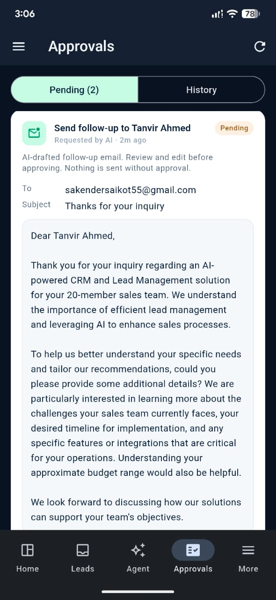</td>
    <td>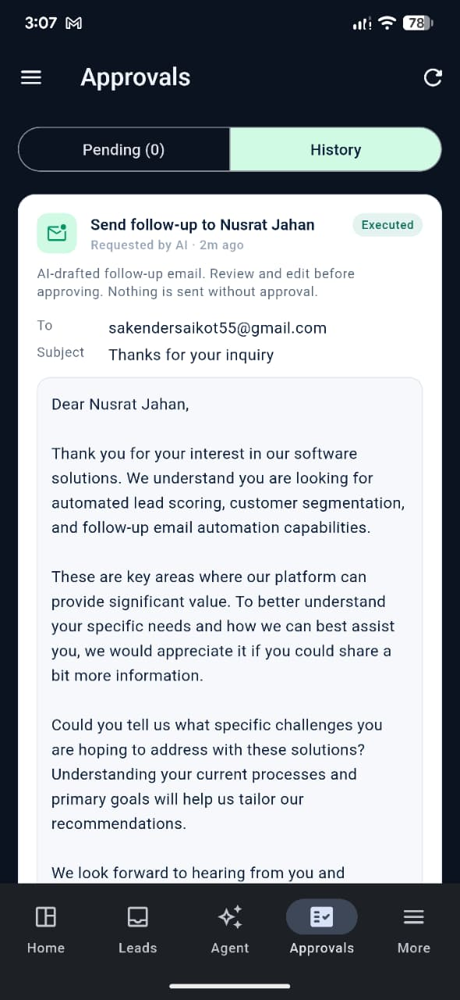</td>
  </tr>
</table>

<br>

<b>📧 Email Verification</b><br><br>
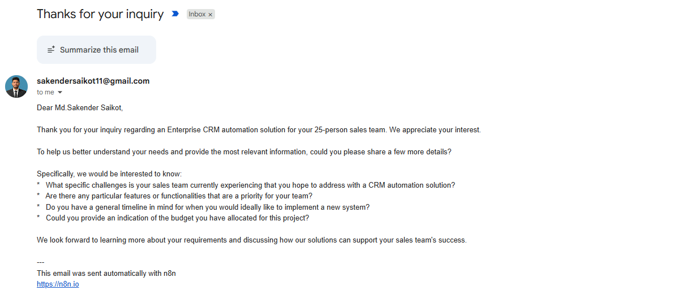
</div>

---

## 🤖 n8n Automation Workflows

LeadPilot AI is organized around **eight dedicated n8n workflows**.

| # | Workflow | Responsibility | Verified |
|:-:|---|---|:-:|
| 01 | 📨 Inquiry Ingestion | Receive and process incoming lead inquiries | ✅ |
| 02 | 🧠 AI Lead Qualification | Coordinate AI-assisted lead assessment | ⏳ |
| 03 | 🧭 Lead Routing & Logging | Route lead activity and record relevant information | ✅ |
| 04 | ✍️ Follow-up Draft Generation | Prepare suggested follow-up messages | ⏳ |
| 05 | 🚀 Approval & Outbound Actions | Handle approval-gated outbound actions | ✅ |
| 06 | 📅 Booking Processing | Coordinate booking-related events | ⏳ |
| 07 | 🛠️ Error Notification & Retry | Handle workflow errors and retry notifications | ⏳ |
| 08 | 📊 Daily Summary Report | Prepare daily operational summaries | ⏳ |

> ✅ = successful execution evidence available  ⏳ = configured, pending independent verification

<details>
<summary><b>🔎 Workflow 01: Inquiry Ingestion</b></summary>
<br>
<p align="center">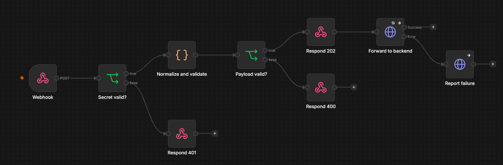</p>
</details>

<details>
<summary><b>🔎 Workflow 02: AI Lead Qualification</b></summary>
<br>
<p align="center">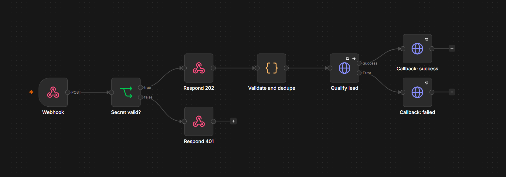</p>
</details>

<details>
<summary><b>🔎 Workflow 03: Lead Routing & Logging</b></summary>
<br>
<p align="center">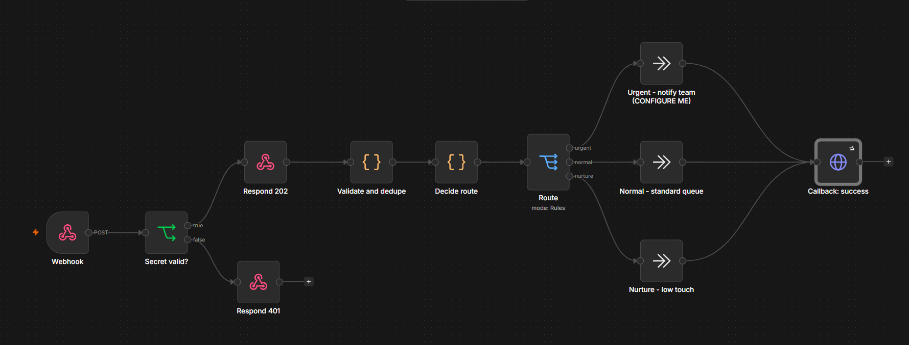</p>
</details>

<details>
<summary><b>🔎 Workflow 04: Follow-up Draft Generation</b></summary>
<br>
<p align="center">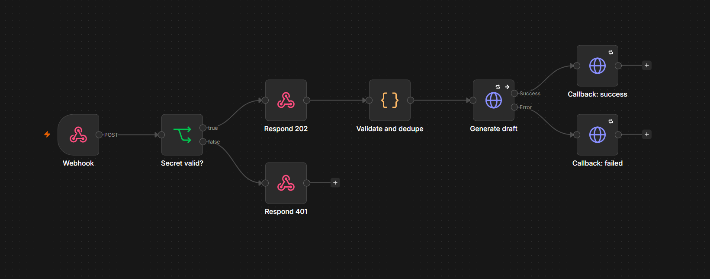</p>
</details>

<details>
<summary><b>🔎 Workflow 05: Approval & Outbound Actions</b></summary>
<br>
<p align="center">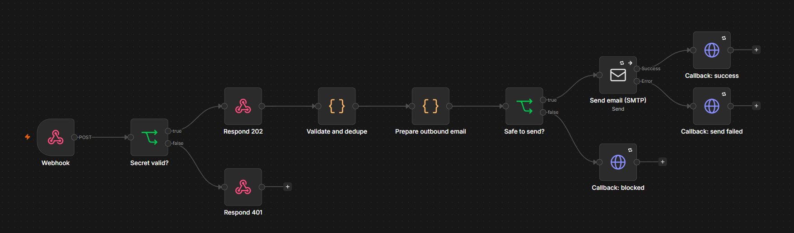</p>
</details>

<details>
<summary><b>🔎 Workflow 06: Booking Processing</b></summary>
<br>
<p align="center">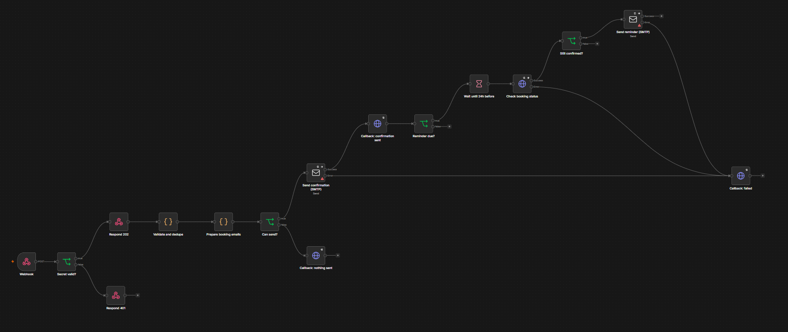</p>
</details>

<details>
<summary><b>🔎 Workflow 07: Error Notification & Retry</b></summary>
<br>
<p align="center">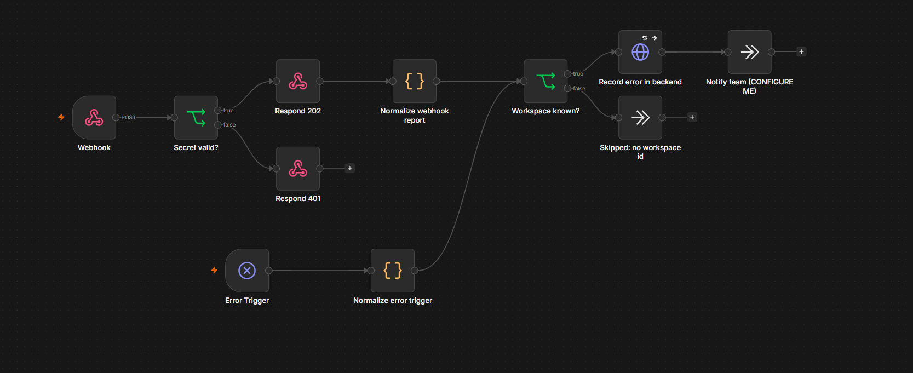</p>
</details>

<details>
<summary><b>🔎 Workflow 08: Daily Summary Report</b></summary>
<br>
<p align="center">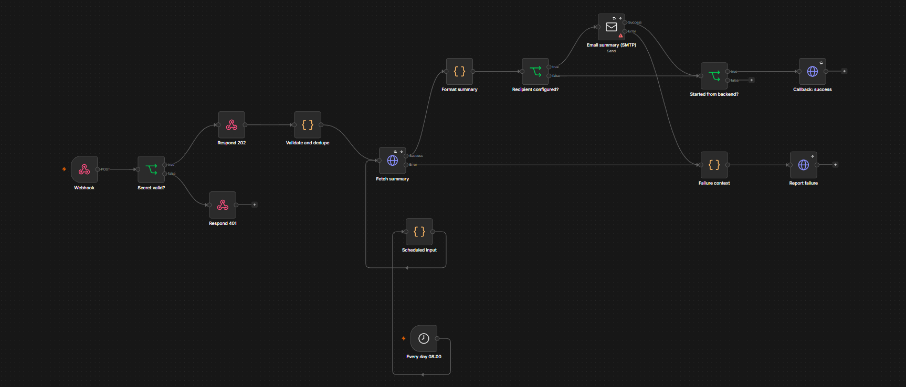</p>
</details>

### ✅ Successful Execution Evidence

Screenshots of successful executions currently captured for three workflows.

<details open>
<summary><b>Workflow 01: Inquiry Ingestion</b></summary>
<br>
<p align="center">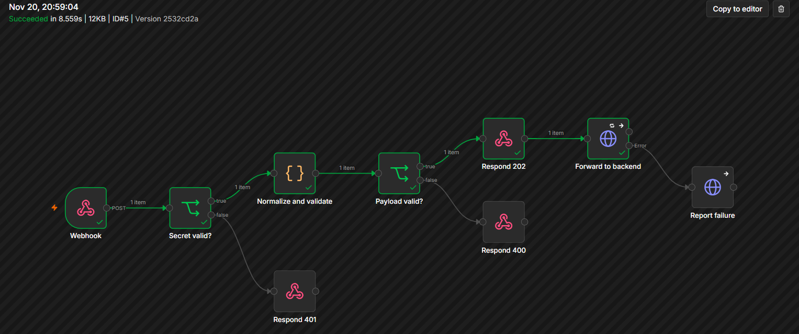</p>
</details>

<details>
<summary><b>Workflow 03: Lead Routing & Logging</b></summary>
<br>
<p align="center">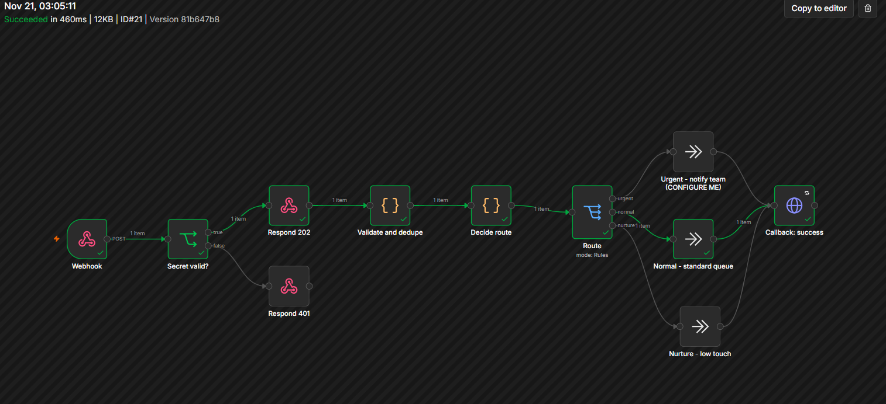</p>
</details>

<details>
<summary><b>Workflow 05: Approval & Outbound Actions</b></summary>
<br>
<p align="center">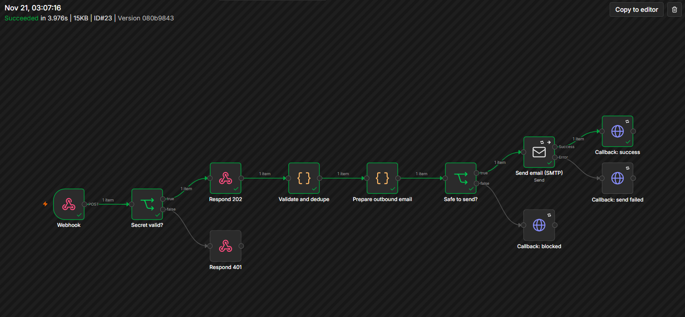</p>
</details>

---

## 🏗️ Architecture

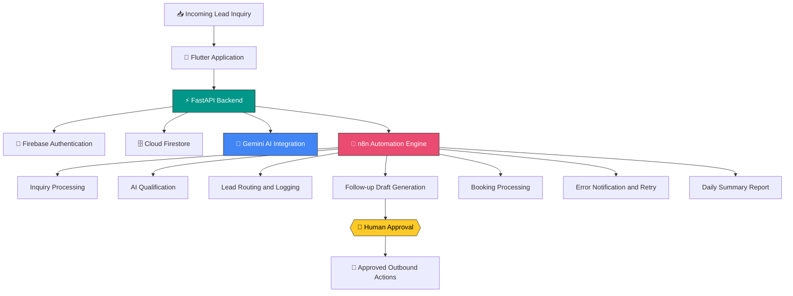

### 🧩 Architecture Components

| Layer | Role |
|---|---|
| 📱 **Frontend** | Flutter-based application for lead and workflow management |
| ⚡ **Backend** | FastAPI for application APIs and service integration |
| 🧠 **AI Engine** | Google Gemini API for lead assessment and content generation |
| 🔐 **Auth & Database** | Firebase Authentication and Cloud Firestore |
| 🤖 **Automation** | n8n for multi-step workflow orchestration |
| 🐳 **Containerization** | Docker Compose for local backend and n8n services |

---

## 🧰 Technology Stack

| Category | Technologies |
|---|---|
| 📱 Frontend | Flutter, Dart |
| ⚡ Backend | Python, FastAPI |
| 🧠 AI Integration | Google Gemini API |
| 🗄️ Database | Firebase Cloud Firestore |
| 🔐 Authentication | Firebase Authentication |
| 🤖 Workflow Automation | n8n |
| 📚 API Documentation | OpenAPI, Swagger UI |
| 🐳 Containerization | Docker, Docker Compose |
| 🔧 Version Control | Git, GitHub |

---

## 🛡️ Engineering & Security

LeadPilot AI is designed around **controlled AI-assisted automation**.

| | Principle | Description |
|:-:|---|---|
| 🧱 | **Structured AI output** | Validate model responses against the expected data structure |
| 🔁 | **Retry handling** | Bounded retries for recoverable AI and integration failures |
| 🕵️ | **Prompt-injection awareness** | Treat external lead messages as untrusted input |
| 👤 | **Human approval** | Approval required for configured customer-facing outbound actions |
| 🔏 | **Webhook protection** | Shared-secret or signed-request checks where configured |
| ♻️ | **Idempotency** | Workflow actions designed to reduce duplicate processing |
| 📜 | **Auditability** | Traces of important application and workflow actions |
| 🏢 | **Workspace-aware access** | Data operations scoped to the authenticated workspace |

> [!IMPORTANT]
> These describe the project's engineering approach and configured controls. They are **not** a blanket production security certification.

---

## ⚙️ Installation & Local Setup

### 📋 Prerequisites

- Git
- Flutter SDK
- Python compatible with backend dependencies
- Docker Desktop
- Firebase project
- Firebase service-account credentials
- Google Gemini API key

### 1️⃣ Clone the repository

```bash
git clone <YOUR_GITHUB_REPOSITORY_URL>
cd LeadpilotAI
```

> Replace the placeholder with your actual repository URL.

### 2️⃣ Configure environment variables

Using PowerShell:

```powershell
Copy-Item .env.example .env
Copy-Item backend/.env.example backend/.env
```

Update the local environment files with your own configuration.

> [!CAUTION]
> **Never commit real `.env` files or credentials.**

### 3️⃣ Configure Firebase credentials

Place the Firebase Admin service-account JSON at the location expected by Docker Compose:

```text
backend/secrets/firebase-sa.json
```

Keep this file private and excluded from version control.

### 4️⃣ Start backend and n8n

```bash
docker compose up --build -d
```

Check running services:

```bash
docker compose ps
```

View logs:

```bash
docker compose logs -f backend
docker compose logs -f n8n
```

### 5️⃣ Access local services

| Service | Local URL |
|---|---|
| ⚡ FastAPI Backend | http://localhost:8080 |
| 📚 Swagger API Docs | http://localhost:8080/docs |
| 🤖 n8n | http://localhost:5678 |

Use the configured port values if your local environment differs.

### 6️⃣ Run the Flutter application

```bash
cd mobile
flutter pub get
flutter run
```

Select an available emulator or connected device. Complete Android SDK setup and configure Firebase client settings for your environment.

---

## 🔧 Configuration

Example environment files:

- `.env.example`
- `backend/.env.example`

| Area | Example variables |
|---|---|
| 🤖 n8n | `N8N_HOST`, `N8N_PORT`, `N8N_WEBHOOK_URL`, `N8N_ENCRYPTION_KEY` |
| 🔑 Service authentication | `N8N_SHARED_SECRET`, `BACKEND_CALLBACK_SECRET` |
| ⚡ Backend | `APP_ENV`, `LOG_LEVEL`, `CORS_ORIGINS` |
| 🧠 AI | `LLM_PROVIDER`, `GEMINI_API_KEY`, `GEMINI_MODEL` |
| 🔐 Firebase | `FIREBASE_PROJECT_ID`, `GOOGLE_APPLICATION_CREDENTIALS` |
| 📧 Email and reporting | `OUTBOUND_FROM_EMAIL`, `SUMMARY_TO_EMAIL` |

> Use the checked-out example files as the source of truth for exact supported variables.

---

## 🧪 Testing Status

**Successful execution evidence currently available:**

- ✅ Workflow 01: Inquiry Ingestion
- ✅ Workflow 03: Lead Routing & Logging
- ✅ Workflow 05: Approval & Outbound Actions

Workflow screenshots are included for all eight named automations. The remaining workflows should be independently tested before being described as successfully executed or production-ready.

**Useful local checks:**

```bash
docker compose config --quiet
docker compose ps
```

**Flutter checks:**

```bash
cd mobile
flutter analyze
flutter test
```

Run backend tests using the test command configured in the repository.

---

## 🔐 Security Notes

- 🚫 Never commit `.env`, Firebase service-account JSON, private keys, API tokens, or real credentials.
- 🔒 Keep Firebase service-account credentials outside version control.
- 🛡️ Apply least-privilege Firebase security rules and backend authorization checks.
- 🌐 Restrict CORS origins outside local development.
- 🔏 Protect n8n and backend webhooks with the configured authentication mechanism.
- 👤 Keep human approval before configured customer-facing outbound messages.
- ♻️ Rotate credentials that may have been exposed in Git history. Removing a file from the latest commit does not remove it from earlier commits.

---

## 🗺️ Roadmap

- [ ] Verify successful execution of workflows 02, 04, 06, 07, and 08
- [ ] Add automated backend tests for lead intake and workspace isolation
- [ ] Add end-to-end tests for inquiry-to-approved-follow-up
- [ ] Add monitoring for workflow failures and integration health
- [ ] Validate retry and idempotency behavior
- [ ] Prepare production deployment documentation

---

<div align="center">

### 🚀 LeadPilot AI
**AI-assisted lead management with controlled, human-approved sales automation.**

<sub>Built with Flutter • FastAPI • Gemini • n8n • Firebase • Docker</sub>

</div>
