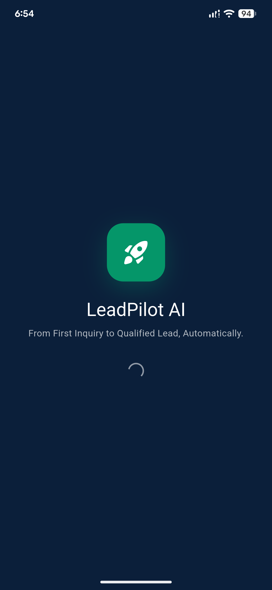

<div align="center">

# LeadPilot AI

### From First Inquiry to Qualified Lead, Automatically.

An early-stage AI-powered lead management and sales automation app concept, currently under active development.


<br/>



*Current visual preview — initial app screen.*

</div>

---

## Overview

**LeadPilot AI** is an early-stage mobile app project built around the idea of helping users move from an initial inquiry toward a qualified lead through a streamlined, AI-assisted workflow.

At this point, the project has an **initial foundation and a preliminary app screen**. Development is ongoing, and the application is **not yet fully runnable or feature-complete**. The screenshot above represents the current visual state, not a claim that the full product workflow is operational.

## Current Project Status

> [!IMPORTANT]
> **Early development — work in progress.** Only an initial stage of the application has been established. The full application flow and functionality are still being developed and have not yet been verified as fully runnable. This repository should not be treated as a finished, stable, or production-ready release.

| Area | Current status |
|---|---|
| Initial app screen / branding | Initial screen available |
| Full end-to-end app flow | In progress |
| Complete feature set | Not yet complete |
| End-to-end runtime verification | Not yet confirmed |
| Production readiness | Not ready |

## Current Preview

The current screenshot is stored in [`screenshot/leadpilot-ai.png`](screenshot/leadpilot-ai.png).

It shows the LeadPilot AI splash screen and the tagline:

> From First Inquiry to Qualified Lead, Automatically.

## Project Direction

The intended direction is to develop LeadPilot AI into a mobile experience focused on lead management and sales workflow assistance. Potential areas of development include:

- Lead capture and lead tracking
- Lead qualification workflows
- Follow-up management
- AI-assisted interactions
- Sales workflow automation

These are **planned directions, not claims of completed functionality**. Features will be marked as implemented only as they are developed and verified.

## Technology

The mobile project is being developed with **Flutter**. Other integrations and technologies will be documented here as they are implemented and verified.

## Running the Project

The application is still under active development, and a complete, reliable run process has not yet been confirmed for all project functionality.

If you are exploring the repository locally, make sure Flutter is installed and review the project configuration before attempting to run it. The following is the usual starting point for a Flutter project, but it **does not guarantee that the current application will run successfully**:

```bash
cd mobile
flutter pub get
flutter run
```

Some features or setup steps may be incomplete while development continues.

## Roadmap

- [x] Establish the initial app screen and visual identity
- [ ] Complete the core application flow
- [ ] Implement and verify lead-management functionality
- [ ] Develop and verify follow-up and automation workflows
- [ ] Validate navigation and app state across screens
- [ ] Complete end-to-end testing
- [ ] Prepare a stable demo or release

The roadmap may change as implementation progresses.

## Contributing / Feedback

This is an evolving project. Feedback, ideas, and constructive suggestions are welcome. Please keep in mind that functionality and project structure may change during active development.

## Disclaimer

LeadPilot AI is currently a **work in progress**. The repository documents an initial development stage and should not be interpreted as a completed product, a fully functional release, or a production-ready application.

---

<div align="center">

**LeadPilot AI** · Initial Development Stage

</div>
